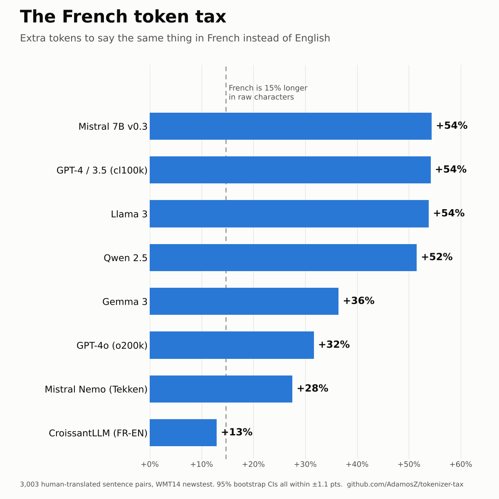

# tokenizer-tax

**How many more tokens does it cost to say the same thing in French instead of English?**

LLMs are billed, rate-limited and context-limited in tokens, and tokenizers are
trained mostly on English. This repo measures the gap on parallel text — the
same sentences in both languages — across eight widely used tokenizers.



## Findings

On 3,003 professionally translated news sentences (WMT14 newstest2014):

- **French is 14.6% longer than English in raw characters.** That part is the
  language, not the tokenizer, and no tokenizer can be blamed for it.
- **Older and English-centric tokenizers roughly add another 40 points on top.**
  GPT-4's cl100k, Llama 3, Mistral 7B and Qwen 2.5 all charge +52–54% for the
  same content: an English prompt that fits in 100k tokens of context needs
  ~154k in French.
- **Newer tokenizers close half the gap.** GPT-4o's o200k (+32%) and Mistral's
  Tekken tokenizer in Mistral Nemo (+28%) roughly halve it. Mistral's own move
  from v0.3 to Tekken took it from the worst on French to second best.
- **A bilingual tokenizer removes it entirely.** CroissantLLM, trained on equal
  French and English data, comes in at +13% — *below* the character baseline,
  meaning it packs French text slightly more efficiently than English.

On 104 real questions from international students about French administration
(from the [Guichet](https://github.com/AdamosZ/Guichet) project), the ranking is
the same and the tax is smaller across the board (cl100k +39%, o200k +19%,
CroissantLLM +5%).

### Full results

`tax` = total French tokens ÷ total English tokens − 1, with a 95% percentile
bootstrap CI over sentence pairs. `chars/tok` = characters per token (higher is
more efficient).

**News — WMT14 newstest2014, 3,003 pairs, human translation**

| Tokenizer | Tax | 95% CI | chars/tok EN | chars/tok FR |
|---|---|---|---|---|
| *(raw characters)* | +14.6% | [+14.0, +15.3] | | |
| GPT-4 / 3.5 (cl100k) | +54.2% | [+53.2, +55.3] | 4.81 | 3.58 |
| Mistral 7B v0.3 | +54.4% | [+53.4, +55.4] | 4.33 | 3.22 |
| Llama 3 | +53.8% | [+52.8, +54.9] | 4.81 | 3.58 |
| Qwen 2.5 | +51.5% | [+50.5, +52.6] | 4.73 | 3.58 |
| Gemma 3 | +36.4% | [+35.6, +37.4] | 4.77 | 4.00 |
| GPT-4o (o200k) | +31.7% | [+30.9, +32.5] | 4.86 | 4.23 |
| Mistral Nemo (Tekken) | +27.5% | [+26.8, +28.3] | 4.67 | 4.20 |
| CroissantLLM (FR-EN) | +12.9% | [+12.3, +13.5] | 4.36 | 4.43 |

**Admin questions — Guichet, 104 pairs, English original + opus-mt French**

| Tokenizer | Tax | 95% CI | chars/tok EN | chars/tok FR |
|---|---|---|---|---|
| *(raw characters)* | +15.8% | [+12.4, +19.0] | | |
| GPT-4 / 3.5 (cl100k) | +39.4% | [+34.3, +44.3] | 4.32 | 3.59 |
| Mistral 7B v0.3 | +45.8% | [+40.2, +51.4] | 4.00 | 3.18 |
| Llama 3 | +39.2% | [+34.2, +44.2] | 4.32 | 3.59 |
| Qwen 2.5 | +36.7% | [+32.0, +41.4] | 4.32 | 3.66 |
| Gemma 3 | +23.2% | [+18.8, +27.6] | 4.33 | 4.07 |
| GPT-4o (o200k) | +18.9% | [+15.2, +22.6] | 4.50 | 4.39 |
| Mistral Nemo (Tekken) | +17.3% | [+13.4, +21.2] | 4.32 | 4.26 |
| CroissantLLM (FR-EN) | +5.1% | [+1.6, +8.5] | 4.31 | 4.75 |

Exact numbers are in [`results/results.csv`](results/results.csv).

## Method

- **Parallel text only.** Every comparison is the same content in both
  languages, so the difference is the tokenizer's (plus the language's own
  length, reported separately as the character baseline).
- **Corpus-level ratio of sums**, not a mean of per-sentence ratios, so long
  sentences weigh more — as they do on a bill.
- **Special tokens excluded** (no BOS/EOS), so short questions aren't inflated.
- **Uncertainty:** 2,000-sample percentile bootstrap over sentence pairs, fixed seed.

## Limitations

- Claude's and Gemini's API tokenizers aren't public, so they aren't included (Gemma 3 is the closest open relative of Gemini's).
- Llama 3, Mistral 7B and Gemma 3 tokenizers are loaded from public mirrors
  (`unsloth/*`) — re-uploads of the official, gated repos, made so the run needs no Hugging Face login.
- The admin set is small (n=104) and its French side is machine-translated, so
  it is a domain check, not the headline.
- News is one register. Legal, technical or conversational French may differ.
- Token count is a proxy for cost and context use; it says nothing about how
  *well* a model understands French.

## Run it

```bash
pip install -e ".[dev]"
python -m tokenizer_tax.run   # downloads WMT14 test + tokenizers, writes results/
pytest -q
```

Add a tokenizer by adding one line to `REGISTRY` in
[`src/tokenizer_tax/tokenizers.py`](src/tokenizer_tax/tokenizers.py).

## Why

Built alongside [Guichet](https://github.com/AdamosZ/Guichet), an evaluation of
cross-lingual retrieval over French administrative documents: if French already
costs more tokens before any retrieval happens, that belongs in the budget.
